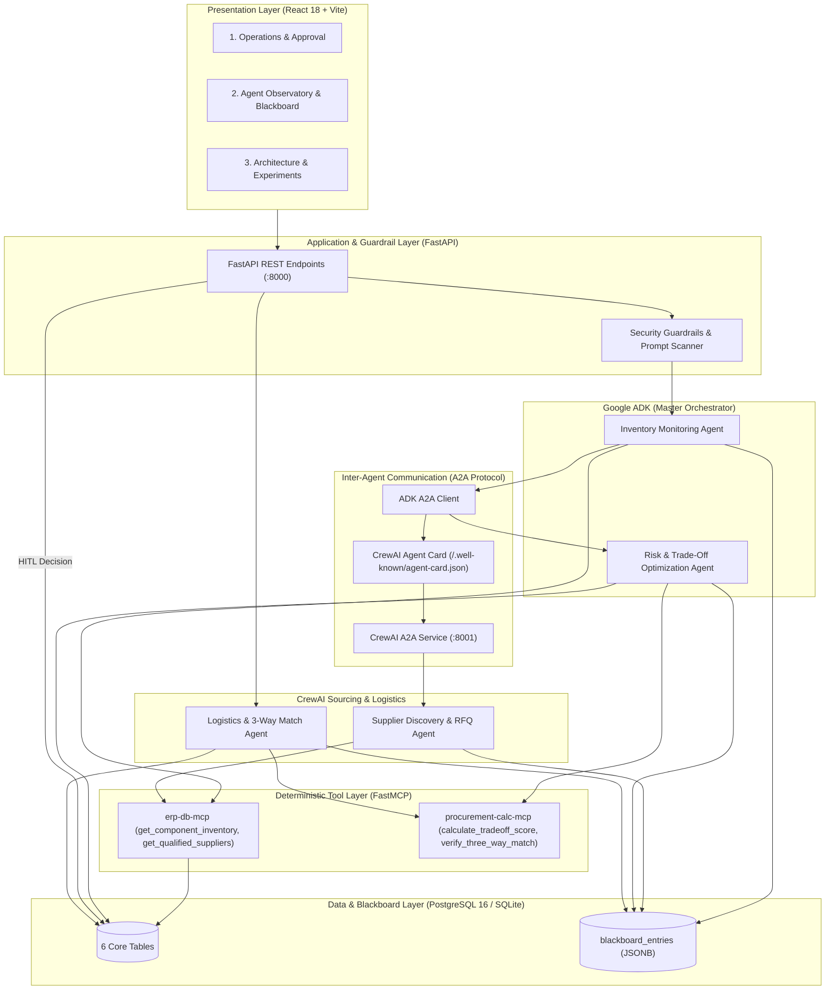

# SupplyChain Autopilot
**Balanced Multi-Agent Procurement and Supply Risk Management System**  
*Version 1.0 Corrected Baseline*

---

## 1. Executive Summary

**SupplyChain Autopilot** is a multi-agent procurement and supply chain risk management platform designed for industrial manufacturing operations. It monitors component inventory against active production schedules, identifies impending stockouts or safety-stock breaches, discovers qualified suppliers, drafts standardized Requests for Quotations (RFQs), deterministically evaluates quotations against acquisition costs and factory downtime risks, routes consequential purchases through an auditable Human-in-the-Loop (HITL) approval gate, and completes deterministic three-way matching across Purchase Orders (PO), Goods Receipt Notes (GRN), and Vendor Invoices.

### v1.0 Architectural Guarantees & Constraints
- **Agentic Frameworks**: **Google Agent Development Kit (ADK)** and **CrewAI only**. (*LangGraph, LangChain, and AutoGen are strictly excluded.*)
- **Inter-Agent Protocol**: **A2A Protocol v1.0** (ADK as orchestrator/client, CrewAI as standalone microservice exposing `/.well-known/agent-card.json`).
- **Tool Integration**: **Two FastMCP servers** (`erp-db-mcp` for read-only ERP lookups and `procurement-calc-mcp` for deterministic scoring and 3-way matching).
- **Shared Context**: **PostgreSQL 16 Blackboard** (`blackboard_entries`), distinctly separated from workflow state (`procurement_workflows`) and temporary session state.
- **Lean Data Model**: Strictly **6 core tables** (`components_inventory`, `suppliers_catalog`, `blackboard_entries`, `procurement_workflows`, `orders_and_invoices`, `benchmark_runs`).
- **Boundaries**: Strictly validated by **5 Pydantic v2 contracts**.
- **Observability**: OpenTelemetry distributed tracing integrated with Arize Phoenix.

---

## 2. System Architecture



---

## 3. Mandatory Review Compliance Matrix

| # | Requirement | Implementation & Evidence |
|---|---|---|
| **1** | **Context sharing and state updates** | PostgreSQL `blackboard_entries` stores versioned, immutable JSONB artifacts with workflow ID, producer agent, framework, and trace ID. |
| **2** | **MCP integration (2+ tools)** | Two FastMCP servers: `erp-db-mcp` (read-only inventory & supplier lookups) and `procurement-calc-mcp` (deterministic multi-criteria scoring and 3-way matching). |
| **3** | **Structured output / Pydantic** | 5 core Pydantic v2 schemas: `ShortageAlert`, `RFQAndQuotesList`, `RiskDecision`, `InvoiceAuditResult`, `FinalWorkflowOutput`. |
| **4** | **Agentic patterns & comparison** | Evaluated across **Sequential Pipeline**, **Pure Blackboard**, and **Hybrid (Supervisor + A2A + Blackboard)**. |
| **5** | **Callbacks & monitoring** | Callbacks capture step durations, token counts, validation status, and errors across ADK and CrewAI. |
| **6** | **A2A interoperability** | ADK acts as A2A client; CrewAI exposes `/.well-known/agent-card.json` and `POST /api/a2a/message/send`. |
| **7** | **ADK and CrewAI only** | ADK handles inventory orchestration and risk scoring; CrewAI handles sourcing/RFQ and invoice audits. No other agent framework used. |
| **8** | **Security & Guardrails** | Strict input boundary scanning for prompt injection, range validation, and persona variants (Cost, Risk, Neutral). |
| **9** | **Observability & provenance** | Distributed tracing across FastAPI, ADK, A2A, CrewAI, and MCP via OpenTelemetry and Arize Phoenix. |
| **10**| **Benchmark evaluation** | **105 reproducible runs** (60 architecture runs + 45 prompt/persona runs) comparing predicted vs realized costs against a heuristic baseline. |

---

## 4. Benchmark & Experimental Results

From the reproducible **105-run evaluation harness** (`evaluation/benchmark.py`):

### Suite A: Architecture Comparison (60 Runs)
| Architecture | Runs | Avg Realized Cost | Avg Downtime Cost | Cost Savings vs Baseline | Mean Latency |
| :--- | :---: | :---: | :---: | :---: | :---: |
| **BASELINE_A** (Cheapest Supplier) | 15 | ₹211,800.00 | ₹175,000.00 | *Baseline* | 1.7 ms |
| **SEQUENTIAL** (Direct Object Passing) | 15 | ₹57,900.00 | ₹10,000.00 | **+72.7%** | 6.0 ms |
| **PURE_BLACKBOARD** (Shared State Polling) | 15 | ₹57,900.00 | ₹10,000.00 | **+72.7%** | 14.6 ms |
| **HYBRID** (ADK Supervisor + Blackboard + A2A) | 30 | ₹67,900.00 | ₹20,000.00 | **+67.9%** | 9.6 ms |

> **Key Finding**: The heuristic baseline chooses the cheapest vendor (₹720/unit), but its 14-day lead time incurs **₹175,000** in factory downtime penalties. The multi-agent system prioritizes delivery timeliness, choosing a supplier with 3-day lead time, reducing total costs by **72.7%**.

### Suite B: Persona Trade-offs under Demand Surge (45 Runs)
| Persona | Runs | Weight Focus | Avg Realized Cost | Avg Downtime Cost | Avg Tokens |
| :--- | :---: | :---: | :---: | :---: | :---: |
| **COST_FOCUSED** | 15 | $w_1=0.70, w_2=0.20, w_3=0.10$ | ₹117,950.00 | ₹75,000.00 | 2,367 |
| **RISK_CONSCIOUS** | 15 | $w_1=0.25, w_2=0.45, w_3=0.30$ | ₹77,900.00 | ₹30,000.00 | 2,367 |
| **NEUTRAL** | 35 | $w_1=0.45, w_2=0.35, w_3=0.20$ | ₹99,885.71 | ₹53,571.43 | 1,807 |

---

## 5. Quickstart & Demonstration

### Prerequisites
- Python 3.11+
- Node.js 18+
- Docker & Docker Compose (optional, for full containerized deployment)

### Option 1: Local Development Setup

1. **Activate Virtual Environment and Install Dependencies**:
   ```bash
   source .venv/bin/activate
   pip install -e packages/contracts
   pip install -r requirements.txt
   ```

2. **Seed Refrigerator Manufacturing Data**:
   ```bash
   PYTHONPATH=. python data/seed/seed_data.py
   ```

3. **Run All Unit & Integration Tests**:
   ```bash
   PYTHONPATH=. pytest
   # 20 passed in ~1.2 seconds
   ```

4. **Execute the 105-Run Benchmark Matrix**:
   ```bash
   PYTHONPATH=. python evaluation/benchmark.py
   ```

5. **Start Services**:
   - Terminal 1 (CrewAI A2A Service):
     ```bash
     PYTHONPATH=. uvicorn services.crewai_service.server:app --port 8001
     ```
   - Terminal 2 (FastAPI Backend):
     ```bash
     PYTHONPATH=. uvicorn services.backend.app.main:app --port 8000
     ```
   - Terminal 3 (React 18 Dashboard):
     ```bash
     cd frontend
     npm run dev
     ```
   Open `http://localhost:3000` to view the 3-tab dashboard.

### Option 2: Docker Compose Deployment
```bash
docker compose up --build
```
- Frontend Dashboard: `http://localhost:3000`
- FastAPI Backend: `http://localhost:8000/docs`
- CrewAI A2A Service: `http://localhost:8001/.well-known/agent-card.json`
- Arize Phoenix Observability: `http://localhost:6006`
